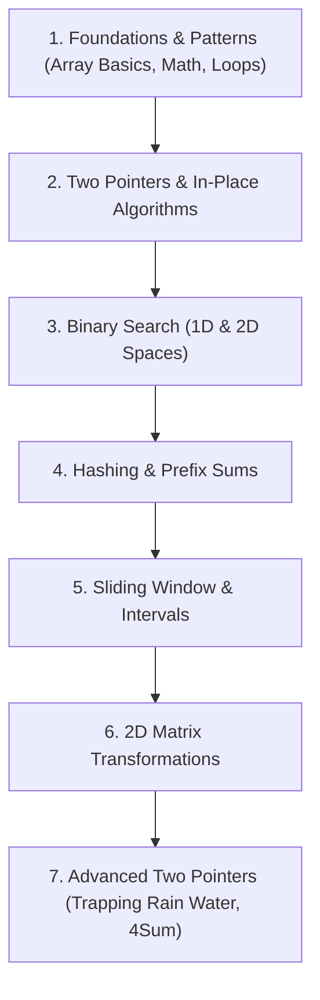

# 🚀 Data Structures & Algorithms (DSA) Master Repository

Welcome to the comprehensive DSA problem-solving guide and code repository. This repository contains curated implementations in Java covering foundational programming problems, algorithmic patterns, and interview questions.

---

## 📊 Repository Summary

- **Total Problems:** 40+ Problems
- **Languages:** Java (Java 17+)
- **Difficulty Breakdown:**
  - 🟢 **Easy:** 21 Problems
  - 🟡 **Medium:** 18 Problems
  - 🔴 **Hard:** 1 Problem

---

## 🗺️ Algorithmic Patterns & Problem Index

### 1. Two Pointers & Multi-Pointers
The two-pointer technique uses two references traversing a sequence concurrently to solve problems in linear or sub-quadratic time, often by sorting first or utilizing opposite ends.

| Problem | Difficulty | File | Time | Space | Key Concept / Technique |
| :--- | :---: | :--- | :---: | :---: | :--- |
| **Sort Array of 0s, 1s, 2s** | 🟡 Medium | [`sort012.java`](./sort012.java) | $\mathcal{O}(N)$ | $\mathcal{O}(1)$ | Dutch National Flag algorithm (low, mid, high pointers) |
| **Container With Most Water** | 🟡 Medium | [`containerWithMostWater.java`](./containerWithMostWater.java) | $\mathcal{O}(N)$ | $\mathcal{O}(1)$ | Inward contraction starting from edges, advancing shorter bar |
| **3Sum** | 🟡 Medium | [`threeSum.java`](./threeSum.java) | $\mathcal{O}(N^2)$ | $\mathcal{O}(1)$ | Sort array, fix first number, two-pointer inward scan with duplicate skipping |
| **4Sum** | 🟡 Medium | [`fourSum.java`](./fourSum.java) | $\mathcal{O}(N^3)$ | $\mathcal{O}(1)$ | Sort array, nested loops for first two numbers, two-pointer scan with overflow protection |
| **Pairs with Difference K** | 🟢 Easy | [`diffPairs.java`](./diffPairs.java) | $\mathcal{O}(N \log N)$ / $\mathcal{O}(N)$ | $\mathcal{O}(1)$ / $\mathcal{O}(N)$ | Finding pairs satisfying $|arr[i] - arr[j]| = K$ |
| **Divisible Sum Pairs** | 🟢 Easy | [`diviSUmPairMain.java`](./diviSUmPairMain.java) | $\mathcal{O}(N^2)$ | $\mathcal{O}(1)$ | Checking pair sums divisible by integer $K$ |
| **Geometric Progression Triplets** | 🟡 Medium | [`triplet.java`](./triplet.java) | $\mathcal{O}(N^3)$ | $\mathcal{O}(1)$ | Finding triplets $(a, b, c)$ satisfying $b^2 = a \cdot c$ |
| **Trapping Rain Water** | 🔴 Hard | [`trappingRainWater.java`](./trappingRainWater.java) | $\mathcal{O}(N)$ | $\mathcal{O}(1)$ | Two pointers maintaining `leftMax` and `rightMax` to compute trapped water |

---

### 2. Binary Search
Efficient $\mathcal{O}(\log N)$ searching on sorted or monotonic search spaces by repeatedly dividing the search interval in half.

| Problem | Difficulty | File | Time | Space | Key Concept / Technique |
| :--- | :---: | :--- | :---: | :---: | :--- |
| **Search in Rotated Sorted Array** | 🟡 Medium | [`searchRotatedSortedArray.java`](./searchRotatedSortedArray.java) | $\mathcal{O}(\log N)$ | $\mathcal{O}(1)$ | Modified binary search checking which half is sorted |
| **Search a 2D Matrix** | 🟡 Medium | [`search2DMatrix.java`](./search2DMatrix.java) | $\mathcal{O}(\log(M \times N))$ | $\mathcal{O}(1)$ | Virtual 1D binary search mapped to 2D indices (`mid / n`, `mid % n`) |
| **Find Peak Element** | 🟡 Medium | [`findPeakElement.java`](./findPeakElement.java) | $\mathcal{O}(\log N)$ | $\mathcal{O}(1)$ | Binary search following ascending slope towards local peak |

---

### 3. Sliding Window
Maintains a contiguous window of elements to process subarray/substring problems in linear time without redundant recalculations.

| Problem | Difficulty | File | Time | Space | Key Concept / Technique |
| :--- | :---: | :--- | :---: | :---: | :--- |
| **Longest Substring Without Repeating Characters** | 🟡 Medium | [`longestSubstringWithoutRepeating.java`](./longestSubstringWithoutRepeating.java) | $\mathcal{O}(N)$ | $\mathcal{O}(\min(N, \Sigma))$ | Dynamic sliding window tracking latest character occurrences |

---

### 4. Prefix Sums & Hashing
Precomputing cumulative sums or tracking observed frequencies in hash maps to achieve $\mathcal{O}(1)$ lookups and subarray calculations.

| Problem | Difficulty | File | Time | Space | Key Concept / Technique |
| :--- | :---: | :--- | :---: | :---: | :--- |
| **Subarray Sum Equals K** | 🟡 Medium | [`subArraySumK.java`](./subArraySumK.java) | $\mathcal{O}(N)$ | $\mathcal{O}(N)$ | Prefix sum frequency hash map checking `prefixSum - k` |
| **Longest Consecutive Sequence** | 🟡 Medium | [`longestConsecutive.java`](./longestConsecutive.java) | $\mathcal{O}(N)$ | $\mathcal{O}(N)$ | HashSet lookup, starting streaks only when `num - 1` is absent |
| **Sum of Array Except Self** | 🟢 Easy | [`sumArrExpSelf.java`](./sumArrExpSelf.java) | $\mathcal{O}(N)$ | $\mathcal{O}(1)$ | Total sum minus current element |
| **Product of Array Except Self** | 🟡 Medium | [`productExceptSelf.java`](./productExceptSelf.java) | $\mathcal{O}(N)$ | $\mathcal{O}(1)$ | Prefix product pass followed by suffix product backward pass without division |

---

### 5. 2D Matrix & Multi-Dimensional Arrays
Techniques for navigating, transforming, and rotating 2D grids and matrices.

| Problem | Difficulty | File | Time | Space | Key Concept / Technique |
| :--- | :---: | :--- | :---: | :---: | :--- |
| **Rotate Matrix by 90° Clockwise** | 🟡 Medium | [`rotateMatrix.java`](./rotateMatrix.java) | $\mathcal{O}(N^2)$ | $\mathcal{O}(1)$ | In-place transposition followed by horizontal row reversal |
| **Spiral Matrix Traversal** | 🟡 Medium | [`spiralMatrix.java`](./spiralMatrix.java) | $\mathcal{O}(M \times N)$ | $\mathcal{O}(1)$ | Clockwise boundary simulation (`top`, `bottom`, `left`, `right`) |

---

### 6. Intervals & Sorting
Managing ranges, intervals, and orderings.

| Problem | Difficulty | File | Time | Space | Key Concept / Technique |
| :--- | :---: | :--- | :---: | :---: | :--- |
| **Merge Overlapping Intervals** | 🟡 Medium | [`mergeIntervals.java`](./mergeIntervals.java) | $\mathcal{O}(N \log N)$ | $\mathcal{O}(N)$ | Sort intervals by start time, merge overlapping bounds sequentially |

---

### 7. Greedy, Permutations & Dynamic Programming
Optimal substructure and choice-based decisions for global optimality.

| Problem | Difficulty | File | Time | Space | Key Concept / Technique |
| :--- | :---: | :--- | :---: | :---: | :--- |
| **Maximum Subarray Sum** | 🟡 Medium | [`maxSubArray.java`](./maxSubArray.java) | $\mathcal{O}(N)$ | $\mathcal{O}(1)$ | Kadane's Algorithm tracking running maximum and resetting negative sums |
| **Majority Element** | 🟢 Easy | [`majorityElement.java`](./majorityElement.java) | $\mathcal{O}(N)$ | $\mathcal{O}(1)$ | Boyer-Moore Voting Algorithm using candidate cancellation |
| **Next Permutation** | 🟡 Medium | [`nextPermutation.java`](./nextPermutation.java) | $\mathcal{O}(N)$ | $\mathcal{O}(1)$ | Pivot identification from right, swap with next larger element, reverse suffix |

---

### 8. Array Fundamentals & Basic Manipulations
Core array manipulations, arithmetic, searches, and rotations.

| Problem | Difficulty | File | Time | Space | Key Concept / Technique |
| :--- | :---: | :--- | :---: | :---: | :--- |
| **Array Adding (Large Integers)** | 🟢 Easy | [`arrAdd.java`](./arrAdd.java) | $\mathcal{O}(\max(N_1, N_2))$ | $\mathcal{O}(\max(N_1, N_2))$ | Column-by-column addition with carry |
| **Array Subtracting (Large Integers)** | 🟡 Medium | [`arrSub.java`](./arrSub.java) | $\mathcal{O}(\max(N_1, N_2))$ | $\mathcal{O}(\max(N_1, N_2))$ | Digit subtraction with borrow handling |
| **Array Basic Operations** | 🟢 Easy | [`arrOp.java`](./arrOp.java) | $\mathcal{O}(N)$ | $\mathcal{O}(1)$ | Calculating sum, floor average, and traversal |
| **Largest Element Index** | 🟢 Easy | [`arrPr1.java`](./arrPr1.java) | $\mathcal{O}(N)$ | $\mathcal{O}(1)$ | Tracking index of maximum value |
| **Count Greater Than Threshold** | 🟢 Easy | [`arrPr2.java`](./arrPr2.java) | $\mathcal{O}(N)$ | $\mathcal{O}(1)$ | Conditional count filter ($> 35$) |
| **Compare Sum of Two Arrays** | 🟢 Easy | [`arrPr3.java`](./arrPr3.java) | $\mathcal{O}(N_1 + N_2)$ | $\mathcal{O}(1)$ | Computing and comparing sums of two distinct arrays |
| **Consecutive Pairs Sum to K** | 🟢 Easy | [`arrPr4.java`](./arrPr4.java) | $\mathcal{O}(N)$ | $\mathcal{O}(1)$ | Adjacent pair verification `arr[i] + arr[i+1] == k` |
| **Last Occurrence Index** | 🟢 Easy | [`lastOcc.java`](./lastOcc.java) | $\mathcal{O}(N)$ | $\mathcal{O}(1)$ | Linear scan to find the final index of a target element |
| **All Indices of Element** | 🟢 Easy | [`lenSer1.java`](./lenSer1.java) | $\mathcal{O}(N)$ | $\mathcal{O}(1)$ | Linear scan printing 1-based indices of target |
| **Second Largest Element** | 🟢 Easy | [`secLar.java`](./secLar.java) | $\mathcal{O}(N)$ | $\mathcal{O}(1)$ | Single-pass tracking of largest and second largest |
| **Dominant Index (At Least Twice)**| 🟢 Easy | [`lestTwice.java`](./lestTwice.java) | $\mathcal{O}(N)$ | $\mathcal{O}(1)$ | Check if max element is at least $2 \times$ every other element |
| **Rotate Array by K Steps** | 🟢 Easy | [`rot.java`](./rot.java) | $\mathcal{O}(N)$ | $\mathcal{O}(1)$ | In-place triple reversal technique |

---

### 9. Mathematics & Number Theory
Foundational mathematical checks and combinatorial logic.

| Problem | Difficulty | File | Time | Space | Key Concept / Technique |
| :--- | :---: | :--- | :---: | :---: | :--- |
| **Armstrong Numbers in Range** | 🟢 Easy | [`armStrNum.java`](./armStrNum.java) | $\mathcal{O}(M \cdot D)$ | $\mathcal{O}(1)$ | Sum of digits raised to the power of number of digits |
| **Primality Test** | 🟢 Easy | [`isprime.java`](./isprime.java) | $\mathcal{O}(\sqrt{N})$ | $\mathcal{O}(1)$ | Trial division up to $\sqrt{N}$ |
| **Combinations ($nCr$)** | 🟢 Easy | [`ncr.java`](./ncr.java) | $\mathcal{O}(R)$ | $\mathcal{O}(1)$ | Efficient computation of $\frac{n!}{r!(n-r)!}$ |

---

### 10. Pattern Printing & Visualizations
Logical construct building using nested loops and formatting.

| Problem | Difficulty | File | Description |
| :--- | :---: | :--- | :--- |
| **Character Pattern** | 🟢 Easy | [`charPat.java`](./charPat.java) | Character grid printing with nested loops |
| **Continuous Cyclic Characters** | 🟢 Easy | [`contCharPat.java`](./contCharPat.java) | Row-based alphabet pattern with cyclic wrap ($Z \rightarrow A$) |
| **Diamond Pattern** | 🟢 Easy | [`dimPat.java`](./dimPat.java) | Symmetrical star diamond centered on odd height $N$ |
| **Descending Number Pattern** | 🟢 Easy | [`priNum.java`](./priNum.java) | $i$-th row printing numbers from $i$ down to $1$ |
| **Right-Angled Fibonacci Triangle**| 🟢 Easy | [`rigAnFib.java`](./rigAnFib.java) | Consecutive Fibonacci numbers formatted as a right triangle |
| **Array Building Bar Chart** | 🟢 Easy | [`arrBuilding.java`](./arrBuilding.java) | Vertical `*` bar chart visualization from array heights |

---

## 🎯 Recommended Learning Roadmap

For optimal interview preparation and foundational mastery, follow this progression order:

1. **Phase 1: Basic Mastery**
   - Start with `arrOp.java`, `secLar.java`, `lestTwice.java`, `rot.java` to get comfortable with array traversals.
2. **Phase 2: Essential Two Pointers & Binary Search**
   - Study `sort012.java`, `containerWithMostWater.java`, and `threeSum.java`.
   - Master binary search variants: `searchRotatedSortedArray.java`, `findPeakElement.java`, `search2DMatrix.java`.
3. **Phase 3: Prefix Sums & Sliding Window**
   - Solve `subArraySumK.java`, `productExceptSelf.java`, and `longestSubstringWithoutRepeating.java`.
4. **Phase 4: Matrix & Intervals**
   - Master in-place transformations with `rotateMatrix.java`, `spiralMatrix.java`, and `mergeIntervals.java`.
5. **Phase 5: Challenging Hard Problems**
   - Tackle `trappingRainWater.java` using two-pointer space optimization.
