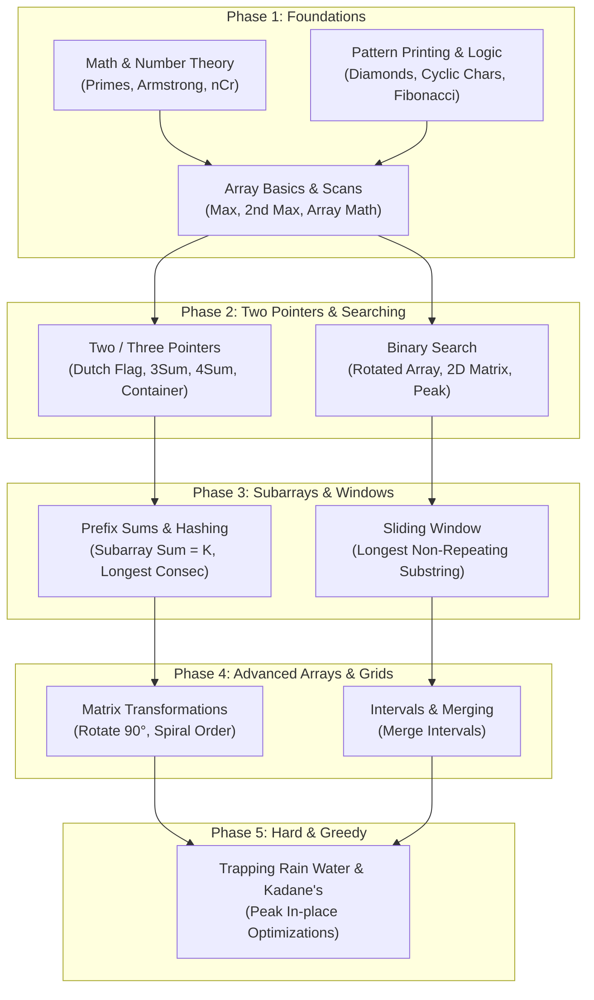

# 🧠 Data Structures & Algorithms (DSA) Interactive Master Guide

<div align="center">


**A structured, pattern-based repository of DSA implementations in Java with time/space complexities, intuitive walkthroughs, and an interactive study tracker.**

[📌 Learning Roadmap](#-interactive-learning-roadmap) • [🎯 Pattern Matrix](#-pattern-decision-matrix) • [🚀 Problem Catalog](#-interactive-problem-catalog) • [💻 How to Run](#-how-to-compile--run)

</div>

---

## 📊 Preparation Progress Tracker

Use the interactive checkboxes below to track your preparation journey. *(You can tick/untick these directly on GitHub!)*

```text
Progress: [████████████████████████████████████████] 42 / 42 Problems Ready
```

- [ ] **Phase 1: Basic Mastery** (Math, Patterns, Basic Arrays) — `15/15`
- [ ] **Phase 2: Core Two-Pointers & Binary Search** — `11/11`
- [ ] **Phase 3: Prefix Sums, HashMaps & Sliding Window** — `5/5`
- [ ] **Phase 4: 2D Matrix & Intervals** — `4/4`
- [ ] **Phase 5: Greedy, Permutations & Hard Challenges** — `7/7`

---

## 📌 Interactive Learning Roadmap

Follow this dependency path to build intuition from ground up:



---

## 🎯 Pattern Decision Matrix

Quick lookup guide for competitive programming and technical interviews:

| If the problem involves... | Consider this Pattern | Target Complexity | Example Problem |
| :--- | :--- | :---: | :--- |
| Sorted array with pairs/triplets | **Two Pointers** | $\mathcal{O}(N)$ or $\mathcal{O}(N^2)$ | [`threeSum.java`](./threeSum.java) |
| Sorted or monotonic sequence looking for target/peak | **Binary Search** | $\mathcal{O}(\log N)$ | [`searchRotatedSortedArray.java`](./searchRotatedSortedArray.java) |
| Contiguous substring or subarray with constraints | **Sliding Window** | $\mathcal{O}(N)$ | [`longestSubstringWithoutRepeating.java`](./longestSubstringWithoutRepeating.java) |
| Continuous subarray sums or frequency matching | **Prefix Sum + HashMap** | $\mathcal{O}(N)$ | [`subArraySumK.java`](./subArraySumK.java) |
| Unsorted elements where order is not required | **HashSet Lookup** | $\mathcal{O}(N)$ | [`longestConsecutive.java`](./longestConsecutive.java) |
| Grid manipulation without auxiliary storage | **In-Place Transposition** | $\mathcal{O}(N^2)$ | [`rotateMatrix.java`](./rotateMatrix.java) |
| Zeroing rows/columns in-place | **First Row & Col As Markers** | $\mathcal{O}(M \times N)$ | [`setMatrixZeroes.java`](./setMatrixZeroes.java) |
| Overlapping time ranges, meetings, or segments | **Sorting by Start Time** | $\mathcal{O}(N \log N)$ | [`mergeIntervals.java`](./mergeIntervals.java) |
| Largest/smallest subarray sum on linear sequence | **Kadane's Greedy Scan** | $\mathcal{O}(N)$ | [`maxSubArray.java`](./maxSubArray.java) |
| Array jumping / reachability | **Greedy Max Reach** | $\mathcal{O}(N)$ | [`jumpGame.java`](./jumpGame.java) |
| Elevation bars trapping liquid | **Dual Boundary Pointers** | $\mathcal{O}(N)$ | [`trappingRainWater.java`](./trappingRainWater.java) |

---

## 🚀 Interactive Problem Catalog

<details open>
<summary><h3>1. 🎯 Two Pointers & Multi-Pointers (8 Problems)</h3></summary>

> **Pattern Essence:** Advance two or more indices towards each other or in lockstep to avoid quadratic brute-force loops.

- [ ] **[Sort Array of 0s, 1s, and 2s](./sort012.java)** `🟡 Medium`
  - **Complexity:** $\mathcal{O}(N)$ time \| $\mathcal{O}(1)$ space
  - <details><summary>💡 <b>Quick Hint & Intuition</b></summary>
    Use the <i>Dutch National Flag algorithm</i> with three pointers: <code>low</code>, <code>mid</code>, and <code>high</code>. Elements before <code>low</code> are 0, after <code>high</code> are 2, and between <code>low</code> and <code>mid</code> are 1.
    </details>

- [ ] **[Container With Most Water](./containerWithMostWater.java)** `🟡 Medium`
  - **Complexity:** $\mathcal{O}(N)$ time \| $\mathcal{O}(1)$ space
  - <details><summary>💡 <b>Quick Hint & Intuition</b></summary>
    Place pointers at opposite ends. The area is bounded by the shorter line; to find a larger area, shift the pointer corresponding to the shorter height inward.
    </details>

- [ ] **[3Sum (Triplets with Sum = 0)](./threeSum.java)** `🟡 Medium`
  - **Complexity:** $\mathcal{O}(N^2)$ time \| $\mathcal{O}(1)$ space
  - <details><summary>💡 <b>Quick Hint & Intuition</b></summary>
    Sort array first. Fix <code>nums[i]</code> and run two-pointer scan for the remaining two numbers. Skip adjacent equal numbers to prevent duplicate triplets.
    </details>

- [ ] **[4Sum (Quadruplets with Sum = Target)](./fourSum.java)** `🟡 Medium`
  - **Complexity:** $\mathcal{O}(N^3)$ time \| $\mathcal{O}(1)$ space
  - <details><summary>💡 <b>Quick Hint & Intuition</b></summary>
    Sort array and use two nested loops for the first two values, followed by two pointers for the remaining pair. Use 64-bit <code>long</code> to avoid integer overflow.
    </details>

- [ ] **[Trapping Rain Water](./trappingRainWater.java)** `🔴 Hard`
  - **Complexity:** $\mathcal{O}(N)$ time \| $\mathcal{O}(1)$ space
  - <details><summary>💡 <b>Quick Hint & Intuition</b></summary>
    Maintain <code>leftMax</code> and <code>rightMax</code>. Process whichever boundary is smaller, adding <code>(boundaryMax - currentHeight)</code> to total trapped water.
    </details>

- [ ] **[Pairs with Difference K](./diffPairs.java)** `🟢 Easy`
  - **Complexity:** $\mathcal{O}(N \log N)$ time \| $\mathcal{O}(1)$ space
  - <details><summary>💡 <b>Quick Hint & Intuition</b></summary>
    Sort or utilize a hash table to find pairs $(i, j)$ satisfying $|arr[i] - arr[j]| = K$.
    </details>

- [ ] **[Divisible Sum Pairs](./diviSUmPairMain.java)** `🟢 Easy`
  - **Complexity:** $\mathcal{O}(N^2)$ / $\mathcal{O}(N)$ time \| $\mathcal{O}(1)$ space
  - <details><summary>💡 <b>Quick Hint & Intuition</b></summary>
    Count pairs where $(arr[i] + arr[j]) \pmod K == 0$.
    </details>

- [ ] **[Geometric Progression Triplets](./triplet.java)** `🟡 Medium`
  - **Complexity:** $\mathcal{O}(N^3)$ / $\mathcal{O}(N^2)$ time \| $\mathcal{O}(1)$ space
  - <details><summary>💡 <b>Quick Hint & Intuition</b></summary>
    Check for GP validity $b^2 = a \cdot c$ using 64-bit integers to prevent numerical overflow.
    </details>

[⬆ Back to Top](#-data-structures--algorithms-dsa-interactive-master-guide)
</details>

---

<details open>
<summary><h3>2. 🔍 Binary Search (3 Problems)</h3></summary>

> **Pattern Essence:** Halve the search domain each iteration on sorted arrays, partitioned spaces, or monotonic answer ranges.

- [ ] **[Search in Rotated Sorted Array](./searchRotatedSortedArray.java)** `🟡 Medium`
  - **Complexity:** $\mathcal{O}(\log N)$ time \| $\mathcal{O}(1)$ space
  - <details><summary>💡 <b>Quick Hint & Intuition</b></summary>
    At any <code>mid</code>, one half is always strictly sorted. Determine which half is sorted, then check if <code>target</code> falls in that interval to discard the other half.
    </details>

- [ ] **[Search a 2D Matrix](./search2DMatrix.java)** `🟡 Medium`
  - **Complexity:** $\mathcal{O}(\log(M \times N))$ time \| $\mathcal{O}(1)$ space
  - <details><summary>💡 <b>Quick Hint & Intuition</b></summary>
    Treat the matrix as a virtual 1D sorted array of length $M \times N$. Map <code>mid</code> to 2D indices via <code>row = mid / N</code> and <code>col = mid % N</code>.
    </details>

- [ ] **[Find Peak Element](./findPeakElement.java)** `🟡 Medium`
  - **Complexity:** $\mathcal{O}(\log N)$ time \| $\mathcal{O}(1)$ space
  - <details><summary>💡 <b>Quick Hint & Intuition</b></summary>
    Compare <code>nums[mid]</code> with <code>nums[mid + 1]</code>. If <code>nums[mid] > nums[mid+1]</code>, a peak must exist on the left slope; otherwise it exists on the right slope.
    </details>

[⬆ Back to Top](#-data-structures--algorithms-dsa-interactive-master-guide)
</details>

---

<details open>
<summary><h3>3. 🪟 Sliding Window (1 Problem)</h3></summary>

> **Pattern Essence:** Expand and contract dynamic windows to track contiguous substring/subarray properties in single passes.

- [ ] **[Longest Substring Without Repeating Characters](./longestSubstringWithoutRepeating.java)** `🟡 Medium`
  - **Complexity:** $\mathcal{O}(N)$ time \| $\mathcal{O}(\min(N, \Sigma))$ space
  - <details><summary>💡 <b>Quick Hint & Intuition</b></summary>
    Store the last seen index of each character in a map. When duplicate character <code>c</code> appears in the window, jump <code>left = lastSeen[c] + 1</code>.
    </details>

[⬆ Back to Top](#-data-structures--algorithms-dsa-interactive-master-guide)
</details>

---

<details open>
<summary><h3>4. ⚡ Prefix Sums & Hashing (4 Problems)</h3></summary>

> **Pattern Essence:** Cumulative aggregations enable $\mathcal{O}(1)$ range queries and frequency-based subarray identification.

- [ ] **[Subarray Sum Equals K](./subArraySumK.java)** `🟡 Medium`
  - **Complexity:** $\mathcal{O}(N)$ time \| $\mathcal{O}(N)$ space
  - <details><summary>💡 <b>Quick Hint & Intuition</b></summary>
    Maintain a running sum. If <code>runningSum - K</code> exists in the prefix map, add its frequency to the total count.
    </details>

- [ ] **[Longest Consecutive Sequence](./longestConsecutive.java)** `🟡 Medium`
  - **Complexity:** $\mathcal{O}(N)$ time \| $\mathcal{O}(N)$ space
  - <details><summary>💡 <b>Quick Hint & Intuition</b></summary>
    Insert all items into a <code>HashSet</code>. Only start counting streaks when <code>num - 1</code> is not in the set to guarantee linear overall work.
    </details>

- [ ] **[Product of Array Except Self](./productExceptSelf.java)** `🟡 Medium`
  - **Complexity:** $\mathcal{O}(N)$ time \| $\mathcal{O}(1)$ auxiliary space
  - <details><summary>💡 <b>Quick Hint & Intuition</b></summary>
    Compute prefix products in a forward pass, then multiply by a running suffix product in a backward pass without division.
    </details>

- [ ] **[Sum of Array Except Self](./sumArrExpSelf.java)** `🟢 Easy`
  - **Complexity:** $\mathcal{O}(N)$ time \| $\mathcal{O}(1)$ space
  - <details><summary>💡 <b>Quick Hint & Intuition</b></summary>
    Calculate total array sum first, then assign <code>result[i] = totalSum - nums[i]</code>.
    </details>

[⬆ Back to Top](#-data-structures--algorithms-dsa-interactive-master-guide)
</details>

---

<details open>
<summary><h3>5. 🔄 2D Matrix & Grids (3 Problems)</h3></summary>

> **Pattern Essence:** Transform and traverse 2D arrays with constant space in-place manipulation.

- [ ] **[Set Matrix Zeroes](./setMatrixZeroes.java)** `🟡 Medium`
  - **Complexity:** $\mathcal{O}(M \times N)$ time \| $\mathcal{O}(1)$ space
  - <details><summary>💡 <b>Quick Hint & Intuition</b></summary>
    Track whether the first row and first column need to be zeroed with boolean flags. Then use the first row and column as markers for the rest of the matrix. Update cells in a second pass, and finally zero out the first row/column if flagged.
    </details>

- [ ] **[Rotate Matrix by 90° Clockwise](./rotateMatrix.java)** `🟡 Medium`
  - **Complexity:** $\mathcal{O}(N^2)$ time \| $\mathcal{O}(1)$ space
  - <details><summary>💡 <b>Quick Hint & Intuition</b></summary>
    1. Transpose the matrix across the main diagonal (<code>swap(matrix[i][j], matrix[j][i])</code>).<br/>
    2. Reverse each row horizontally using two pointers.
    </details>

- [ ] **[Spiral Matrix Traversal](./spiralMatrix.java)** `🟡 Medium`
  - **Complexity:** $\mathcal{O}(M \times N)$ time \| $\mathcal{O}(1)$ space
  - <details><summary>💡 <b>Quick Hint & Intuition</b></summary>
    Maintain four boundary pointers (<code>top</code>, <code>bottom</code>, <code>left</code>, <code>right</code>) and simulate inward clockwise steps while updating limits.
    </details>

[⬆ Back to Top](#-data-structures--algorithms-dsa-interactive-master-guide)
</details>

---

<details open>
<summary><h3>6. ⏱️ Intervals & Sorting (1 Problem)</h3></summary>

> **Pattern Essence:** Order intervals chronologically to resolve overlap conflicts in linear sweeps.

- [ ] **[Merge Overlapping Intervals](./mergeIntervals.java)** `🟡 Medium`
  - **Complexity:** $\mathcal{O}(N \log N)$ time \| $\mathcal{O}(N)$ space
  - <details><summary>💡 <b>Quick Hint & Intuition</b></summary>
    Sort intervals by start coordinate. If current interval overlaps with previous (<code>prev.end >= curr.start</code>), merge by setting <code>prev.end = max(prev.end, curr.end)</code>.
    </details>

[⬆ Back to Top](#-data-structures--algorithms-dsa-interactive-master-guide)
</details>

---

<details open>
<summary><h3>7. 💡 Greedy, Permutations & Voting (4 Problems)</h3></summary>

> **Pattern Essence:** Local optimal choices lead to global solutions with minimal space overhead.

- [ ] **[Jump Game](./jumpGame.java)** `🟡 Medium`
  - **Complexity:** $\mathcal{O}(N)$ time \| $\mathcal{O}(1)$ space
  - <details><summary>💡 <b>Quick Hint & Intuition</b></summary>
    Maintain a running <code>maxReach</code>. At each index <code>i</code>, if <code>i > maxReach</code>, return false. Otherwise update <code>maxReach = max(maxReach, i + nums[i])</code> and return true if <code>maxReach >= n - 1</code>.
    </details>

- [ ] **[Maximum Subarray Sum (Kadane's Algorithm)](./maxSubArray.java)** `🟡 Medium`
  - **Complexity:** $\mathcal{O}(N)$ time \| $\mathcal{O}(1)$ space
  - <details><summary>💡 <b>Quick Hint & Intuition</b></summary>
    Accumulate <code>currentSum</code>. Update <code>maxSum = max(maxSum, currentSum)</code>. If <code>currentSum < 0</code>, reset it to 0.
    </details>

- [ ] **[Majority Element (Boyer-Moore Voting)](./majorityElement.java)** `🟢 Easy`
  - **Complexity:** $\mathcal{O}(N)$ time \| $\mathcal{O}(1)$ space
  - <details><summary>💡 <b>Quick Hint & Intuition</b></summary>
    Maintain <code>candidate</code> and <code>count</code>. Increment when matching candidate, decrement when different. Majority element cancels all others.
    </details>

- [ ] **[Next Permutation](./nextPermutation.java)** `🟡 Medium`
  - **Complexity:** $\mathcal{O}(N)$ time \| $\mathcal{O}(1)$ space
  - <details><summary>💡 <b>Quick Hint & Intuition</b></summary>
    Find first decreasing element from right (pivot), swap with element just larger than it from the right, then reverse everything after pivot.
    </details>

[⬆ Back to Top](#-data-structures--algorithms-dsa-interactive-master-guide)
</details>

---

<details open>
<summary><h3>8. 🧱 Array Fundamentals & Linear Traversal (12 Problems)</h3></summary>

> **Pattern Essence:** Core mechanics of indexing, digit math, element comparisons, and single-pass queries.

- [ ] **[Rotate Array by K Steps](./rot.java)** `🟢 Easy` — $\mathcal{O}(N)$ time \| $\mathcal{O}(1)$ space (Triple reversal trick)
- [ ] **[Second Largest Element](./secLar.java)** `🟢 Easy` — $\mathcal{O}(N)$ time \| $\mathcal{O}(1)$ space (Single pass two-variable tracking)
- [ ] **[Dominant Index (At Least Twice as Large)](./lestTwice.java)** `🟢 Easy` — $\mathcal{O}(N)$ time \| $\mathcal{O}(1)$ space
- [ ] **[Array Adding (Large Number Arithmetic)](./arrAdd.java)** `🟢 Easy` — $\mathcal{O}(\max(N_1, N_2))$ time (Digit carry addition)
- [ ] **[Array Subtracting (Large Number Arithmetic)](./arrSub.java)** `🟡 Medium` — $\mathcal{O}(\max(N_1, N_2))$ time (Digit borrow subtraction)
- [ ] **[Basic Array Operations](./arrOp.java)** `🟢 Easy` — Sum, floor average, and traversal
- [ ] **[Largest Element Index](./arrPr1.java)** `🟢 Easy` — Linear scan for maximum value index
- [ ] **[Count Above Threshold (> 35)](./arrPr2.java)** `🟢 Easy` — Conditional count filter
- [ ] **[Compare Sum of Two Arrays](./arrPr3.java)** `🟢 Easy` — Sum comparison between arrays
- [ ] **[Consecutive Pairs Sum to K](./arrPr4.java)** `🟢 Easy` — Sliding adjacent pair check
- [ ] **[Last Occurrence Index](./lastOcc.java)** `🟢 Easy` — Backward or forward linear search
- [ ] **[All Indices of Target Element](./lenSer1.java)** `🟢 Easy` — 1-based indexing collector

[⬆ Back to Top](#-data-structures--algorithms-dsa-interactive-master-guide)
</details>

---

<details open>
<summary><h3>9. 🔢 Math & Number Theory (3 Problems)</h3></summary>

- [ ] **[Armstrong Numbers in Range](./armStrNum.java)** `🟢 Easy` — Sum of $D$-th powers of digits
- [ ] **[Primality Test](./isprime.java)** `🟢 Easy` — $\mathcal{O}(\sqrt{N})$ trial division
- [ ] **[Combinations (nCr)](./ncr.java)** `🟢 Easy` — Combinatorial computation $\frac{n!}{r!(n-r)!}$

[⬆ Back to Top](#-data-structures--algorithms-dsa-interactive-master-guide)
</details>

---

<details open>
<summary><h3>10. ✨ Pattern Printing & Geometry (6 Problems)</h3></summary>

- [ ] **[Diamond Star Pattern](./dimPat.java)** `🟢 Easy` — Symmetrical diamond for odd height $N$
- [ ] **[Continuous Cyclic Characters](./contCharPat.java)** `🟢 Easy` — Cyclic alphabet wrapper ($Z \rightarrow A$)
- [ ] **[Character Pattern Grid](./charPat.java)** `🟢 Easy` — 2D character box patterns
- [ ] **[Descending Number Pattern](./priNum.java)** `🟢 Easy` — Line $i$ prints from $i$ down to $1$
- [ ] **[Right-Angled Fibonacci Triangle](./rigAnFib.java)** `🟢 Easy` — Fibonacci sequence arranged triangularly
- [ ] **[Array Building Bar Chart](./arrBuilding.java)** `🟢 Easy` — Vertical asterisk bar visualization

[⬆ Back to Top](#-data-structures--algorithms-dsa-interactive-master-guide)
</details>

---

## 💻 How to Compile & Run

All solutions are standalone executable Java programs with standard `main` driver functions.

### Compile Any Problem
```bash
javac sort012.java
```

### Run with Direct Input
```bash
java sort012
# Then provide problem input via terminal
```

### Run with Pipe / Test Cases (PowerShell)
```powershell
echo "5`n2 0 2 1 1 0" | java sort012
# Output: 0 0 1 1 2 2
```

---

<div align="center">
⭐ <i>Star this repository to follow along with daily DSA additions and interview patterns!</i>
</div>
